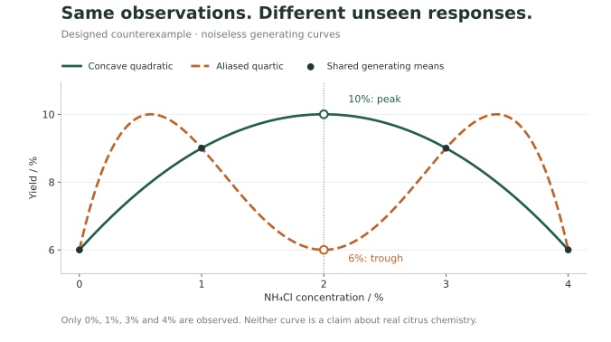

# EchoClass Scientific

柑橘精油提取记录、审核决定，以及一次计算实际使用的输入。

[English](README.md) · [中文](README.zh.md)

**3.0.0-beta.25 · 科学软件原型**。技术栈为 Node.js 24、TypeScript、SQLite 和 Python 3.12.13。

更正一条观测，不应悄悄改变旧报告的含义。项目分别保留原始提交、追加审核事件和封存的计算输入。这份公开快照仅包含合成数据和由代码绘制的图形，不包含实验照片、教学视频、二进制分子模型或课堂数据库。

## 从一份结果开始

已提交的[测试输入](tests/fixtures/scientific/synthetic-envelope.json)包含二十条虚构观测，浓度为 0%、1%、3%、4%。1% 和 3% 组的均值得率都为 9%；二次模型提出约 2% 的候选点，但没有观测测过这里。

[方法比较](docs/method-study.md)保留一个反例：两条响应曲线在已测浓度相同，在中间却不同。研究保留简单基线和全部固定试验结果，区分计算可复现与未测最优条件的识别。



[后续测量设计](docs/followup-design.md)在生成新响应之前选定位置，说明噪声和判别前提，再用固定模拟核对理论误判率。交互讲解在 `/engineering#next-measurement`。

## 运行合成案例

按英文 README 准备 Linux、Node.js 24 与 Python 3.12.13，并安装锁定依赖。正式计算进程合同采用 Linux 本地文件系统，尚未认证 Windows 或其他架构。

```sh
npm run project:trace -- --text --lang zh
npm run project:trace -- --json
npm run scientific:study -- --text
npm run scientific:design -- --text
npm start
```

追踪命令校验二十份输入摘要、有序数据集清单、审核绑定与执行指纹，再运行实际 Python 计算。它只改动分离的内存副本，验证原摘要拒绝改变后的字节，并重新检查原件；不写入课堂记录、审核、报告或测试文件。

`/`、`/engineering`、`/walkthrough` 默认英文，可切换中文。原生阅读与展开控件不依赖 JavaScript。科学分析、解释、CSV 和附件界面使用同一个语言偏好；原始数据、引用和重试标识保持不变。旧课堂兼容流程仍有中文界面，使用另一份合成数据。

## 对照源码阅读

- [中文阅读指南](docs/project-trace.zh.md)与[英文阅读指南](docs/project-trace.en.md)将问题对应到代码和检查。
- [科学分析服务](src/application/scientific-service.ts)负责选择输入与报告生命周期。
- [Python 计算包](analytics/echoclass_analytics)实现统计和复算。
- [科学流程集成测试](tests/integration/scientific-workflows.test.ts)检查 HTTP、数据库与计算进程之间的行为。

```sh
npm run publication:check
npm run lint
npm run typecheck
npm test
npm run test:python
npm run test:integration
npm run eval:grounded
npm run eval:retrieval
npm run smoke-test
npm run security-check
npm run format:check
```

[CI](.github/workflows/ci.yml)执行这些检查，[实际容器流水线](.github/workflows/scientific-container.yml)另外验证非 root 镜像中的计算、追踪命令与重启复算。测试和评测题用于开发回归，不代表未见问题准确率或独立真人验收。

## 项目范围

这是小数据科学原型，不证明并行加速、大规模吞吐、经过验证的提取最优条件、抑菌效果或课堂收益。Bootstrap 区间假设观测独立，软件不能证明这种独立性。[公开快照说明](docs/public-snapshot.md)记录了发布内容与私有历史部署的区别。

AI 工具参与了实现、测试、调试、文档和界面工作，[开发记录](docs/engineering-notes.md#development-and-tool-assistance)说明了使用范围。此仓库从整理后的源码快照开始；链接的代码、测试和可运行示例记录了实现及其核验过程。
