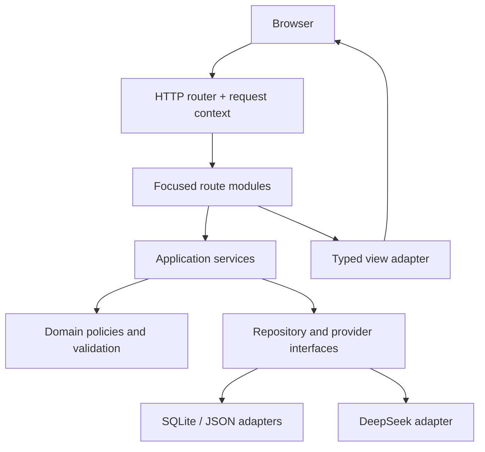

# EchoClass architecture

EchoClass is a native Node.js HTTP application with a server-rendered interface. Its TypeScript architecture follows dependency direction from transport toward domain ports; SQLite/JSON and DeepSeek details remain at the outside edge.



## HTTP layer

`src/http/router.ts` creates a request ID, applies security headers and the origin guard, restores the session, dispatches focused route modules, maps errors, and emits one structured completion log. Route modules parse transport data, invoke services, and translate results to HTML, redirects, or JSON. They do not contain SQL or provider credentials.

JSON failures use this stable envelope:

```json
{
  "ok": false,
  "error": {
    "code": "VALIDATION_ERROR",
    "message": "Readable description",
    "fields": []
  },
  "request_id": "..."
}
```

Supported application codes are `VALIDATION_ERROR`, `AUTHENTICATION_REQUIRED`, `PASSWORD_CHANGE_REQUIRED`, `FORBIDDEN`, `NOT_FOUND`, `RATE_LIMITED`, `CONFLICT`, `INTERNAL_ERROR`, and `PROVIDER_UNAVAILABLE`. Unexpected failures are converted to a generic message; stack traces, SQL, paths, and secrets are not returned.

English-default public reading and account pages resolve a strict `en`/`zh` query choice, then a preference cookie. Language affects display copy rather than record values or scientific identity. Temporary-password sessions are gated before protected route dispatch; pure domain role/class policies retain the same restriction. The [credential boundary](credential-session-boundary.md) describes migration 017, guarded session creation and fresh-sign-in behaviour.

## Application layer

- `AuthService` orchestrates login throttling, credential verification, session creation/revocation, password changes, and auth audit events.
- `ExperimentService` derives trusted identity/class scope, generates canonical IDs and calculated values, validates records, runs deterministic diagnostics, persists through a repository port, and returns scoped offline-ID mappings.
- `ReviewService` authorizes review decisions, appends immutable history events, exposes authorized history, and retains a transactional current-state compatibility projection.
- `AIService` validates length, redacts supported PII, limits request rates, calls the provider port, validates the response, and returns a safe fallback.
- `AdminService` owns account import/upsert and generated temporary-password reset orchestration.
- `PracticeService`, `ClassSummaryService`, and `OperationsService` own practice persistence, authorized summary construction, and protected operational queries.

Services depend on interfaces defined in `src/domain/repositories.ts` and `src/application/ports.ts`, not on SQLite or `fetch` implementations.

## Domain layer

`src/domain/types.ts` defines `User`, `UserRole`, `Classroom`, `Session`, client-writable `CreateExperimentCommand`, server-owned `ExperimentRecord`, `RecordReview`, `AuditEvent`, `AIQuestion`, and `AIResponse`. Authorization is centralized in pure policies. Strict experiment transport parsing lives in HTTP; domain range validation, diagnostics, and descriptive analytics remain pure and testable without starting HTTP.

Legacy descriptive analytics remain for compatibility. The separate sealed scientific pipeline now runs Python calculations through ScientificService, a durable dispatcher and a private local worker. Its canonical input/result contracts and code/environment identity govern reproduction; see scientific-protocol.md.

## Infrastructure layer and repository pattern

The application uses explicit repositories rather than a generic CRUD abstraction:

- `UserRepository`
- `SessionRepository`
- `LoginAttemptRepository`
- `ExperimentRepository`
- `ReviewRepository`
- `AnalysisRepository`
- `AuditRepository`
- `MetricsRepository`
- `PracticeRepository`

`src/infrastructure/repositories/storage-adapter.ts` implements those ports over the existing engine. SQLite schema/SQL and JSON fallback behavior live in `src/infrastructure/database/storage.js`; route and service modules cannot import it directly. This preserves the proven storage behavior while giving tests mockable boundaries.

Milestone 2A moves authoritative scientific persistence into normalized `experiment_records`, immutable `record_reviews`, and analysis provenance foundations behind `SqliteProvenanceStore`. Ordered migration modules and their atomic runner live under `src/infrastructure/database/migrations`. Milestone 2A.1 hardens this boundary with an exact-prefix append-only migration ledger, strict legacy preflight, database-maintained review ordering/projection, immutable versioned analysis snapshots, allow-listed atomic record updates, and soft deletion. The JSON adapter remains explicit compatibility/demo mode and does not claim equivalent constraint, concurrency, migration, or review-history guarantees.

Milestone 2A.10 freezes released migrations 001–011 and the dedicated version-2 preflight by fingerprint. The generic transactional runner invokes the preflight attached to the historical migration definition, with an executable manifest-binding test. Migration 006 preserves point-in-time review binding; Migration 007 adds trusted-clock ordinary run creation and exact selection-time binding; Migration 008 atomically seals an observed ordered input set and freezes first-terminal outputs; Migration 009 requires a non-empty, dense, record-unique sealed set with explicit historical provenance classification; and Migration 010 enforces canonical attribution, deletion and classification-ledger authority. Migration 011 prospectively binds every new legacy review to a legacy snapshot record in its still-open durable import batch. Migration 012 uses the existing migration-owned classification ledger and legacy/unverified analysis representation to quarantine definite historical canonical/legacy-review contradictions without rewriting review or snapshot evidence. Current write paths share recursive JSON-safe, machine-identity, Unicode blank-text and monotonic record-version contracts. Reads validate immutable stored snapshots rather than the later record version. No application service receives a raw SQLite handle.

Creating a record, updating an editable observation set, importing a legacy JSON snapshot, appending a review event, and creating a pending analysis run plus exact input snapshots each use focused transactions. Ordinary `ExperimentRepository.add` is authoritative-only and cannot access the infrastructure import bypass. Startup legacy import instead opens a durable batch and commits `batch -> users -> records -> reviews -> completion marker` as one transaction; a deferred database relationship makes an uncompleted batch uncommittable. The concrete `importReview` capability is infrastructure-only and verifies the active transaction, legacy target, immutable batch link and absent completion marker; `ReviewRepository` exposes only ordinary authorized human review. `CreateAnalysisRunCommand` contains only caller-writable identity/configuration fields; repository clocks own creation and terminal timestamps. Review insertion triggers allocate monotonic event order and update the effective pointer/projection atomically; application code cannot manufacture those links. Core scientific fields are typed columns; `metadata_json` is extension-only and is never import authority. See [the data model](data-model.md) and [Milestone 2A design](milestone-2a-design.md).

## Authorization flow

```text
session cookie
  -> hashed session lookup
  -> authenticated Session
  -> required role policy
  -> class-scope policy
  -> repository operation
```

Students and teachers are scoped to their session class. Administrators have cross-class scope. Hiding a UI control is never considered authorization; record retrieval and mutation policies run on the server. Integration tests prove that both student and teacher sessions cannot retrieve or manage an administrator-created record in another class.

## Request lifecycle

1. Apply headers and assign `X-Request-Id`.
2. Parse the URL and reject explicit cross-origin state-changing requests.
3. Restore a session through `SessionRepository`.
4. Parse and validate the transport payload.
5. Invoke an application service.
6. Apply domain validation/authorization inside the workflow.
7. Use a repository/provider port for external effects.
8. Return a compatible HTML/JSON/redirect response.
9. Log timestamp, level, request ID, event, route, actor role when known, result, status, and duration.

Logs do not contain passwords, session tokens, API keys, full prompts, SQL, or personal identifiers.

## View boundary

The existing templates remain in `src/views/pages.js` to preserve the UI. `src/views/legacy-view-adapter.ts` gives the TypeScript HTTP layer an explicit typed contract. Views receive prepared records/users/session values and import pure domain analytics; they perform no database access, authorization, or provider requests.

The project/account and four data-workflow views use an English-primary `en`/`zh` presentation. The operational catalog is shared by trusted static markup and a same-origin browser helper. A separate reading layer projects cited evidence fields into English without rewriting the canonical evidence pack or its hashes. Locale links retain the authorized page target; API commands and retry identities remain unchanged. Original records and source excerpts bypass the catalog. See [the presentation boundary](operation-language.md).

## AI provider boundary

The legacy `src/infrastructure/llm/deepseek-provider.ts` performs general explanation requests. The separate `grounded-ranker.ts` adapter can only reorder fixed evidence-card IDs; its dedicated credential and opt-in configuration do not grant claim-writing authority. The adapter reads validated configuration, enforces a timeout, validates the response shape, caps returned content, and degrades to a local teaching explanation. `AIService` owns PII redaction, history shaping, application rate limiting, and audit metadata. Prompts and provider credentials are never written to audit logs.

## Milestone 2B.1 CSV boundary

`CsvService` depends only on `CsvRepository`, `CsvCodec`, `ContentHasher` and the existing limiter port. Pure CSV mapping supplements the existing domain validator. `NodeCsvCodec` owns strict parsing, raw hashing and deterministic serialization. `SqliteCsvRepository` owns the focused synchronous batch transaction and reuses `SqliteProvenanceStore.add` on the same connection. Its fixed class cohort uses stable class identity, including after class renaming. The router reads bounded raw bytes and does not contain SQL. `/csv` renders CSV values using textContent. JSON mode has no CSV persistence fallback and returns `STORAGE_UNAVAILABLE` (503).

The dependency-direction gate includes all new source files. No LLM participates in parsing, diagnostics, permission checks or commit decisions. See [CSV v1](csv-interchange-v1.md) for budgets, transport and retry rules.

## Scientific and grounded boundaries

`ScientificService` authorizes current report scope; `SqliteScientificRepository` seals inputs/results and durable job intent. `LocalPythonWorker` supervises the private FastAPI process; only sealed canonical data enters its methods. `GroundedService` extracts validated report evidence or invokes the `DocumentRetriever` port. `SqliteDocumentRetriever` builds a read-only, in-memory FTS5 index from the bundled first-party Markdown. It does not access classroom tables, attachments, URLs or an external model. Search excerpts are independent of the report calculations. Current authorization is rechecked after audit waits and immediately before HTTP serialization. The bounded cache contains only terms found in returned public guide sections, never arbitrary raw questions.

No database schema changed in beta.17. The FTS index is a rebuildable process-local projection; deployed Markdown plus its content-addressed corpus identity are authoritative. Persistent document ingestion and AI question/response tables from the original roadmap are still pending.
