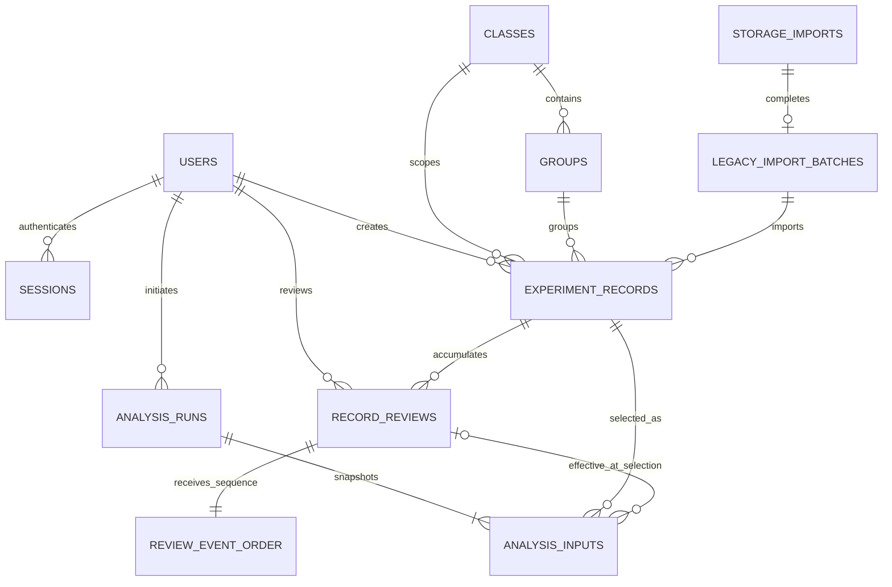

# EchoClass data model

EchoClass uses SQLite as its authoritative scientific persistence engine. JSON mode remains an explicitly selected compatibility/demo adapter and does not provide the guarantees described here.

## Entity relationship diagram

## Table purposes

### `schema_migrations`

Records each stable migration version/name and its successful application timestamp. Applied rows must be an exact ordered prefix of known migrations. Triggers reject update, delete and duplicate/replacement paths.

### `classes` and `groups`

`classes` retains the current unique classroom catalogue. `groups` adds a class-scoped stable identity with `UNIQUE(class_id, name)`. Record rows keep class/group name snapshots for backward-compatible display while foreign keys protect normalized relationships.

### `users`, `sessions`, `login_attempts`, and `audit_logs`

These existing operational tables continue to support authentication, throttling and metadata-safe auditing. User updates use `ON CONFLICT DO UPDATE`, not delete-and-reinsert, so active session, review and analysis foreign keys remain valid.

### `experiment_records`

One canonical scientific submission. Core values used for validation, authorization, filtering, grouping, diagnostics, yield calculation and review are typed columns. Important categories are:

- identity/provenance: server ID, optional offline client ID, creator user/label, class/group IDs and name snapshots, plus an optional durable legacy-import batch ID;
- workflow: experiment type, active/deleted lifecycle, effective review pointer and timestamps;
- submitted scientific values: NH4Cl concentration, masses, time, phase score, emulsification observations, E. coli group, inhibition zone, colony score, anomaly flag, error source and note;
- measurement provenance: optional experiment date, optional petri-dish diameter and an explicit direct/local-calibrated/not-recorded method;
- derived/server state: yield and current review compatibility projection;
- preserved context: immutable `submitted_json`, `submission_kind`, optional non-authoritative `metadata_json`.

`submitted_json` for new rows is the validated canonical submission command before server-derived/review fields. A migrated row is marked `legacy_canonical_snapshot` because the old database retained only its canonical `data_json`, not the exact pre-validation transport body.

### `record_reviews`

An immutable review decision. `human` rows have server IDs, reviewer linkage, decision, reason and timestamps. `legacy_projection` rows explicitly preserve the one effective decision available from the previous schema without claiming missing history or identity.

SQLite triggers reject `UPDATE`, `DELETE`, replacement and duplicate-ID mutation paths. `review_event_order` assigns a monotonic integer sequence while public review IDs remain unchanged. One `AFTER INSERT` trigger sets `effective_review_id` and all compatibility projection fields, so direct infrastructure inserts cannot leave them stale.

Migration 011 prospectively permits a new `legacy_projection` row only when its target is a `legacy_canonical_snapshot` record with a non-null `storage_import_id`, the matching `legacy_import_batches` row exists, and no completion marker exists in `storage_imports`. Repository import additionally requires the active startup-import transaction. Existing historical rows are not rewritten or deleted because the pre-011 schema did not retain per-review batch membership or review insertion time. Authorized `human` review remains governed by its existing reviewer, role, status, trusted-clock and chronology contract after batch completion.

Migration 012 classifies the definite historical inconsistency `canonical_submission` + `legacy_projection` as `legacy_review_authority_unverified`. It preserves the review row and all snapshot JSON bytes, downgrades any exact input that directly binds or snapshots the offending effective review, and marks the containing exact run `legacy_unverified`. The classification blocks future exact selection through the existing unverified-evidence boundary. A `legacy_canonical_snapshot` review is not quarantined merely because old schemas lacked per-review batch membership or insertion time.

### `review_event_order`

An append-only monotonic sequence for every review ID. It resolves timestamp ties without treating random text IDs as time.

### `analysis_runs`

A future analysis execution envelope: dataset hash, algorithm/configuration/code versions, status and result metadata. Identity/configuration fields are immutable. The explicit state method permits pending work to remain pending or advance to running/completed/failed, running work to remain running or terminate, and terminal states only to remain terminal; completed/failed updates require a completion timestamp. Milestone 2A creates no rows during normal startup and implements no statistical algorithm.

### `analysis_inputs`

An ordered input set for one run. Each row links the source record and optional review event effective at selection time while retaining immutable record/review JSON snapshots and an input hash. `review_binding_mode` records `effective`, `omit`, `none`, or migration-only `legacy_unspecified`; `review_omission_reason` is required only for an explicit omission. At insertion, effective binding must use the current latest event. Later reads validate the exact stored event, so a future review does not invalidate an older run. The full SQLite v1 contract independently validates structure/science and exact temporal binding. `snapshot_schema` is `echoclass.analysis-input.v1` for valid inputs and `echoclass.analysis-input.legacy` for historical inputs that cannot honestly satisfy that contract.

### `storage_imports`

An append-only completion ledger for the one-time JSON startup snapshot import. It records source/target counts and whether an empty SQLite database was imported or an existing SQLite database remained authoritative. A legacy-import batch uses the same ID as its completion marker.

### `legacy_import_batches`

A durable authority record for infrastructure-only legacy JSON import. Its deferred foreign key to the final `storage_imports` marker makes an opened batch impossible to commit without completion. Imported records reference the batch through `storage_import_id`; batch metadata, record links and completion markers are immutable. Database triggers reject over-quota rows, appends after completion and markers whose source/counts do not match the open batch and final database state.

### `provenance_boundary_classifications`

A versioned ledger for limitations that a migration can establish but cannot reconstruct or safely rewrite. Migration 010 validates released Migration 008/009 rows against their exact version/name/time, taxonomy and target-entity contracts, appends its own truthful classifications, then installs an unconditional insert seal. Ordinary runtime `INSERT`, `INSERT OR IGNORE`, `INSERT OR REPLACE`, explicit-ID insertion, update and deletion all fail. A future migration may write only by explicitly removing and reinstalling the seal inside its own migration transaction.

## Primary and foreign keys

- Application entities use server-generated text primary keys.
- `experiment_records.created_by_user_id` is nullable only for legacy attribution that cannot be reconstructed; every ordinary authenticated write requires an existing user and a creator label matching that user's current username or name.
- Record class is required; group and creator foreign keys may become null only under their documented `SET NULL` behavior.
- Reviews use `ON DELETE RESTRICT` for records, preventing deletion of scientific review history.
- Analysis input records/reviews use `RESTRICT`. The historical input-to-run foreign key retains `ON DELETE CASCADE`, but Migration 010 directly rejects every analysis-run deletion, so that cascade is not an ordinary or privileged removal path.

`PRAGMA foreign_keys=ON` is set and verified at startup. Migration tests run `PRAGMA foreign_key_check` after legacy conversion.

## Important constraints

- record lifecycle, review decision/status, anomaly flag, submission kind, analysis status and ordinal use focused `CHECK` constraints;
- class/group names are unique in their actual scope;
- the partial unique offline index protects `(created_by_user_id, idempotency_scope_class_id, client_submission_id)` only when a client ID exists; the immutable scope preserves the original authorized class across later reclassification, and canonical client IDs require a non-null authenticated creator;
- record IDs, review IDs and analysis run IDs remain independently unique;
- `analysis_inputs` has both ordered primary-key identity and per-run record uniqueness.

Application validation still owns scientific ranges and authorization. Database constraints protect structural and high-value integrity rather than duplicating every domain rule.

Canonical online rows have no client token or idempotency scope and are not marked offline. Canonical offline rows require all three of an authenticated creator, a client submission token and the immutable initial-class scope equal to the row's class. The explicit legacy import path is a separate infrastructure capability, writes `legacy_canonical_snapshot`, and requires a verifiable open import batch rather than caller-controlled metadata.

## Important indexes

| Index                                        | Access pattern                               | Trade-off                        |
| -------------------------------------------- | -------------------------------------------- | -------------------------------- |
| `idx_experiment_records_class_created`       | authorized class listing ordered by creation | write/storage overhead           |
| `idx_experiment_records_creator_created`     | creator provenance lookup                    | write/storage overhead           |
| `idx_experiment_records_class_concentration` | current class/concentration grouping         | write/storage overhead           |
| `uq_experiment_records_offline_submission`   | durable actor/class offline idempotency      | rejects duplicate legitimate key |
| `idx_record_reviews_record_created`          | history and latest effective review          | append overhead                  |
| `idx_record_reviews_reviewer_created`        | reviewer audit lookup                        | append overhead                  |
| `idx_analysis_inputs_record`                 | record-to-analysis provenance lookup         | analysis-input insert overhead   |

An `EXPLAIN QUERY PLAN` test confirms the class/time listing query can select its intended index. No latency or throughput claim is made.

## Review history semantics

A review is an event, not a mutable property. `ReviewService` authorizes the actor and appends one event using one server timestamp. Database insertion assigns monotonic order and updates the effective pointer/projection. Older events remain queryable by sequence; equal timestamps cannot create ambiguity.

Students cannot review. Teachers are class-scoped. Administrators retain current cross-class behavior. JSON compatibility mode records a best-effort history in its record document but is not claimed to have SQLite append-only guarantees.

## Analysis provenance semantics

Creating a future run and all inputs is one transaction. Ordinary creation accepts a `CreateAnalysisRunCommand`, starts in `pending`, and receives its `created_at` from an injected trusted clock. Each versioned input snapshot includes normalized scientific and measurement values, ownership/class/group identifiers, derived yield, lifecycle/timestamps and the explicitly linked review snapshot when selected. At insertion it must exactly match the durable record, including creator/offline provenance, AI text and the semantic metadata object; later record edits/reviews cannot mutate or replace the stored input.

Dataset/input hashes, algorithm version, configuration, code version and timestamps provide the persistence foundation for later reproducibility checks. They do not constitute a scientific analysis implementation.

## Migration and versioning model

Migration modules live in `src/infrastructure/database/migrations/` and execute in ascending numeric order. Each version runs inside `BEGIN IMMEDIATE`; its metadata row is inserted only before commit. Errors roll back and propagate so startup cannot silently accept a partially migrated database.

Fresh databases apply migrations 001 through 012. Released migrations 001–011 and the version-2 preflight artifact are immutable and protected by accepted Git-blob fingerprints. Accepted legacy databases first record the baseline migration, then convert `records` to `experiment_records`, verify the row count and remove the obsolete table in the same transaction. Migration 006 adds temporal analysis and historical-submission preflight. Migration 007 adds the analysis-run state/JSON/time contract and exact selection-time record binding. Migration 008 adds one-way analysis-input sealing, first-terminal result immutability, canonical new-write timestamps and printable-identity guards. Migration 009 adds complete non-empty dataset sealing, explicit `exact`/`legacy_incomplete`/`legacy_unverified` run classification, strict current write boundaries, and a versioned append-only provenance-classification ledger. Migration 010 validates that ledger, introduces durable legacy-import batch authority, enforces canonical attribution/offline contracts, directly prevents record/run deletion, and seals classification writes outside migrations. Migration 011 adds the prospective legacy-review import guard. Migration 012 quarantines definite historical canonical/legacy-review contradictions without rewriting earlier migration sources, reviews or snapshot bytes. Repeated startup observes the exact ledger prefix and performs no duplicate work.

Before frozen migration 002 writes schema, every legacy row receives its frozen dedicated preflight inside the same `BEGIN IMMEDIATE` transaction. Migration 006 re-evaluates historical review binding using run time, exact event sequence and immutable event time. Migration 007 fails with run/input IDs for definite run corruption or record contradiction. Migration 008 classifies its accepted offset grammar and seals the input sets it observes. Migration 009 validates real Gregorian offset dates, detects empty/gapped/duplicate sealed sets, forged none/omit projections, archived-at-selection claims, review chronology gaps, recursive JSON loss, and record-version timestamp collisions. Migration 010 begins by checking the expected absence of its new guards, foreign-key consistency, canonical/offline contradictions, legacy-import evidence and every released classification row. Migration 011 verifies its schema-10 tables, required columns, trigger absence and foreign-key consistency before installing its prospective review guard. Migration 012 verifies schema-11 guards and foreign keys, opens only the classification insert seal inside its migration transaction, appends quarantine evidence, downgrades affected exact analysis claims and reinstalls every temporary seal. Definite corruption fails with entity/field evidence; history that the released schema did not preserve is not fabricated or silently rewritten. Legitimate point-in-time inputs remain readable after later edits, reviews and archival.

The beta.11 supported upgrade boundary remains a fresh database or an existing database whose `schema_migrations` ledger already records the accepted Migration 008. A durable schema-v7 database can still stop inside immutable Migration 008 when a valid historical reviewer was later renamed, disabled or assigned a different role; Migration 012 cannot repair a database it never reaches. Repository evidence cannot establish whether such an external database exists; owner attestation or a separately approved copy-based compatibility process is required before claiming a general schema-v7 upgrade.

Original `submitted_json`, submission kind, canonical ID, creator, creation time, client submission identity, idempotency class scope and legacy `storage_import_id` are immutable after insertion. Human `included`/`excluded` projection is valid only when it exactly matches the latest monotonic review event; automated initial `normal`/`review` quality state is distinct from human review.

Ordinary teacher deletion is a soft lifecycle transition to `status='deleted'` with a strictly advanced `updated_at`. Normal lists hide the row, while canonical values, submission snapshot, reviews and analysis links remain available to explicitly scoped infrastructure audit queries. Direct physical deletion of either an active or archived record, and direct deletion of an analysis run, is rejected even when no child row currently provides an indirect foreign-key barrier; failed deletion therefore cannot release an offline idempotency token.

There is no automatic down migration. Scientific data rollback uses an owner-verified backup and the prior application, avoiding a destructive automated reversal.

## Schema 13: immutable CSV completion facts

Migration `013-csv-interchange.ts` (`13`, `csv_interchange`) adds `csv_import_batches` and `csv_import_rows`, both STRICT. Numbered migrations 001–012 and 002 preflight remain byte-for-byte unchanged. Existing experiment scientific columns and analysis snapshot v1 are unchanged.

`csv_import_batches` stores uploader/class IDs, token, schema, raw SHA-256, byte/row counts, server timestamps, uploader/class label snapshots, app version and diagnostics policy. Its unique domain is `(uploader_user_id,class_id,client_import_id)`. It represents completion only, with no pending/failed task status. `csv_import_rows` maps the logical 1-based data row to a unique canonical record ID. The batch FK is deferred until COMMIT, while record ownership, contiguous count and seal constraints are checked before inserting the parent completion. No complete parent means no committable mappings.

Both tables reject update/delete and replacement; completed parents reject additional rows. Their restrictive references preserve provenance through later soft deletion and corrections. The immutable snapshots record initial identity, while receipt reads re-evaluate current session, user and class authority. Each completed batch has one successful audit written in the same transaction. Raw file bytes are not stored. The database cannot recompute a file hash or prove scientific authenticity without the original file.
