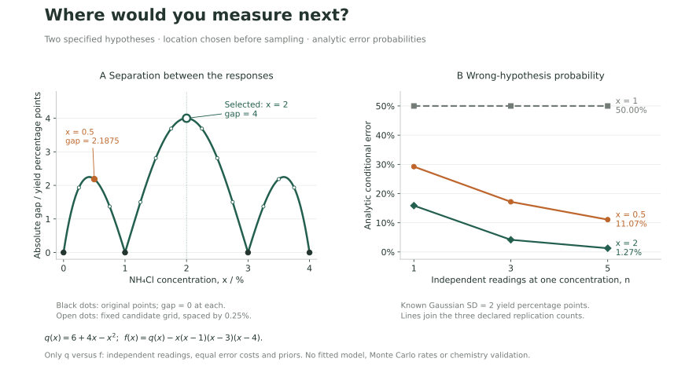

# Where would you measure next?

The [method study](method-study.md) ends with two invented curves that agree at every tested concentration. This follow-up asks what a new measurement can resolve **if those two curves are the only hypotheses under consideration**. It does not infer the true chemical response, update the production model or claim to have run a laboratory experiment.

## Choose a question before collecting an answer

Keep the two fully specified responses:

$$q(x)=6+4x-x^2,\qquad f(x)=q(x)-x(x-1)(x-3)(x-4).$$

The original concentrations are 0, 1, 3 and 4. At all four, the predicted means coincide. Further repeats there can improve estimation of those means, but cannot distinguish this exact pair under the same observation-noise law. A small standard error cannot repair a location where the hypotheses predict the same thing.

The design fixes seventeen feasible concentrations, from 0 to 4 in steps of 0.25, and chooses the point with the largest absolute difference between the two predicted means. Selection uses the specified hypotheses before generating any new responses. No simulated success rate selects the location or the seeds.

The selected concentration is 2: the predictions are 10 and 6, separated by four yield percentage points. This also maximizes the separation on the entire interval, not only on the grid. To check this, put $u=(x-2)^2\in[0,4]$. Then $q(x)-f(x)=u^2-5u+4$, whose range on that interval is $[-9/4,4]$. The largest absolute value is 4, attained only when $u=0$, or $x=2$.

The comparison retains two other choices: repeating the original concentration 1, and measuring at 0.5. At 0.5, $q=7.75$ and $f=9.9375$: their ordering reverses, which also checks that the decision rule does not always associate a larger response with the quadratic.



## Declare what makes the calculation possible

For this follow-up alone, a new reading has a normal error with **known** standard deviation $\sigma\in\{1,2,4\}$ yield percentage points. There are $n\in\{1,3,5\}$ independent readings at the chosen concentration. The errors are independent of the earlier synthetic observations; those observations are not reused to estimate a parameter or noise level.

This differs deliberately from the bounded uniform noise in the earlier method study. These are new mathematical experiments with unrounded, unclipped Gaussian readings, which can fall outside the physical yield range. They do not pass through the classroom record validator or scientific worker. Their purpose is to make the statistical decision and its error analytically inspectable.

Choose whichever specified mean is closer to the new sample mean. With equal prior probabilities, equal error costs and the same known variance under each hypothesis, the midpoint is the decision boundary. For either generating hypothesis, the theoretical error probability is

$$P(\text{wrong hypothesis})=\Phi\!\left(-\frac{|q(x)-f(x)|\sqrt n}{2\sigma}\right),$$

where $\Phi$ is the standard normal cumulative distribution function. Derivation: the sample mean has standard deviation $\sigma/\sqrt n$, and the midpoint is half the separation from either true mean. The wrong decision lies beyond that boundary. At a zero gap, both likelihoods are identical; the implementation alternates the two labels by trial index, without observing the truth. This gives exactly 50% errors for each truth in the even-sized simulation panel. It is a balanced tie rule, not a successful inference.

The relationship explains two distinct ways to improve this restricted decision: increase separation by moving the measurement, or reduce uncertainty in the mean by independent replication. It also explains why repeated measurements at zero separation do not help. Independence matters: five repeated readings of one biased preparation need not supply five independent experimental units.

## A useful slice of the calculation

With known record-noise SD of 2 yield percentage points, the theoretical conditional error is:

| New concentration     | Prediction gap | 1 independent reading | 3 independent readings | 5 independent readings |
| --------------------- | -------------: | --------------------: | ---------------------: | ---------------------: |
| 1, an original point  |              0 |                50.00% |                 50.00% |                 50.00% |
| 0.5                   |         2.1875 |                29.22% |                 17.18% |                 11.07% |
| 2, maximum separation |              4 |                15.87% |                  4.16% |                  1.27% |

These are probabilities under the stated model, not observed classroom accuracy, confidence intervals or the probability that a chemical mechanism is true. The engineering page at `/engineering#next-measurement` lets a reader vary the location, noise and number of readings. It displays the theoretical calculation, not a randomly selected simulation outcome.

The fixed [configuration](../analytics/experiments/followup-design-v1.config.json) also specifies 10,000 simulated trials for each truth/noise/replicate combination. There are 18 random batches, reused across the three locations for paired comparisons: 54 conditional cells and 540,000 classification decisions. Those decisions are not 540,000 independent datasets. The [complete report](../resources/experiments/followup-design-v1.json) retains both conditional error counts, tie counts, theoretical errors, equal-prior averages, seed tuples, design predictions and runtime/source identity. The 27 equal-prior rows do not conceal either conditional error rate. Finite simulation differences from theory are Monte Carlo variation, not evidence of a new physical effect. Zero observed mistakes does not mean zero theoretical risk.

## One more point does not identify an arbitrary curve

After measuring 2, the two original hypotheses become distinguishable under these assumptions. But consider a third response,

$$g(x)=q(x)-x(x-1)(x-2)(x-3)(x-4).$$

It agrees with $q$ at all five concentrations: 0, 1, 2, 3 and 4. At 0.5, however, it gives 4.46875 while $q$ gives 7.75. Adding a point breaks the original alias without identifying every possible response. A finite number of observations still needs a justified model family, knowledge of the experiment, and an appropriate noise model before supporting broader claims.

This distinction is the reason for the follow-up: identifying a weakness in the existing data should lead to a specific experimental question, with conditions under which the proposed measurement helps. It should not lead to a new unqualified optimum claim.

## Reproduce the design and inspect the boundary

Use the locked Python environment described in [the case guide](reproducible-case.md), then run:

```sh
npm ci
npm run build
export ECHOCLASS_PYTHON="$PWD/.venv/bin/python"
npm run scientific:design -- --text
node scripts/followup-design.mjs --json > followup-design.json
PYTHONPATH=analytics "$ECHOCLASS_PYTHON" -m experiments.audit_followup_design followup-design.json
python3 scripts/generate-followup-lookup.py --check
```

The Node wrapper rejects malformed or incomplete output and bounds process time and output size. The separate audit reconstructs predictions, normal-tail probabilities and the fixed Monte Carlo counts without importing the generator. Regression tests deliberately corrupt scientific fields. These are bounded AI-assisted consistency checks; they do not supply independent human statistical acceptance.

The browser's lookup is generated from Python's standard-library normal-tail calculation and is separate from the simulation output. No provider, account, classroom data, browser storage or live statistical inference is needed to use it. The initial example remains readable without JavaScript.

The figure plots the same analytic quantities, with no selected trial or empirical uncertainty band. Regenerate it with `python scripts/render-followup-design.py --output-dir /tmp/echoclass-followup-figures --png` in the optional Matplotlib environment described in [the method study](method-study.md#reproduce-and-inspect).

The design is limited to two known functions, common known variance, independent readings, equal error costs, equal priors for the displayed average and the specified concentration domain. Unequal costs or priors change the threshold; unequal or unknown variances, fitted function parameters, experimental cost and correlated errors require a new protocol. This is a fixed demonstration of hypothesis discrimination, not a general optimal-experiment-design engine or a validated next-experiment recommendation for citrus extraction.
