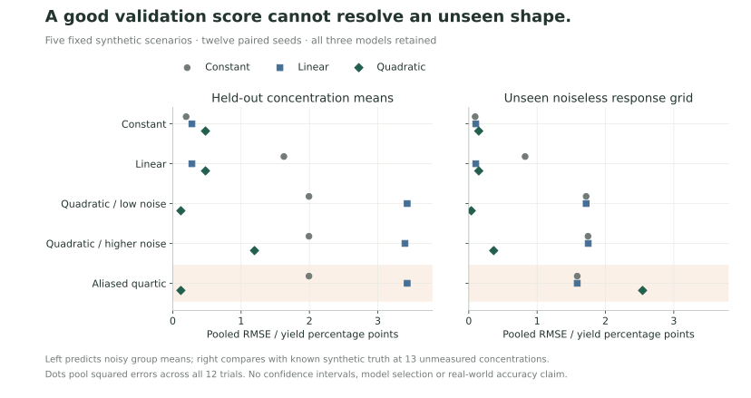

# Four concentrations do not identify every response curve

This study asks a narrow question: when does the production quadratic describe an unmeasured response well, and when can its validation score be misleading? All observations are generated. None are classroom or laboratory measurements.

## The counterexample

Let the tested concentrations be $x \in \{0,1,3,4\}$. Consider

$$q(x)=6+4x-x^2$$

and

$$f(x)=q(x)-x(x-1)(x-3)(x-4)=6+4(x-2)^2-(x-2)^4.$$

The subtracted product is zero at every tested concentration. Both functions therefore produce the same four noiseless means: 6, 9, 9 and 6. At the unmeasured concentration 2, however, $q(2)=10$ while $f(2)=6$. The quadratic has its maximum there; the quartic has two maxima at $2\pm\sqrt{2}$, both with yield 10.


The low-noise quadratic and quartic scenarios use exactly the same random errors and record identities. Each paired trial has identical sealed inputs, execution identity, bootstrap seed and production result hash. The generating function is held outside the analysis envelope. It is used only afterwards to score the predictions.

This construction is deliberately adversarial. It does not claim that the quartic is a plausible extraction mechanism. It demonstrates that the observed data alone cannot rule it out. Better software can preserve what was measured; it cannot supply missing information about the response between measurements.

## Fixed design

The [versioned configuration](../analytics/experiments/method-study-v1.config.json) fixes the scenarios and seeds. It was specified before the first study run, without selecting outcomes or tuning the model. It is not an independently preregistered or held-out benchmark.

| Generating response     | Record-noise SD, yield percentage points | Purpose                                                       |
| ----------------------- | ---------------------------------------: | ------------------------------------------------------------- |
| Constant: $8$           |                                      0.4 | Check the cost of unnecessary flexibility                     |
| Linear: $6+0.75x$       |                                      0.4 | Compare the quadratic with a sufficient simpler model         |
| Quadratic: $q(x)$       |                                      0.1 | Check the intended model in a low-noise setting               |
| Quadratic: $q(x)$       |                                      1.0 | Separate noise sensitivity from misspecification              |
| Aliased quartic: $f(x)$ |                                      0.1 | Expose an unidentified response between tested concentrations |

Each scenario uses seeds 1201–1212, four concentrations and five records per concentration. Record errors are independent draws from a bounded, zero-mean uniform distribution with the specified standard deviation. The same standard draws are paired across scenarios. Observations are rounded to 0.01 yield percentage points; no clipping, rejection sampling or seed selection is used. These are 60 scenario–seed runs with 48 distinct observed datasets because the 12 alias pairs deliberately reuse their observations. They are not 60 independent empirical experiments.

Every model fits the four concentration means with equal weight. The constant model predicts the training mean; the linear model fits an intercept and slope; the quadratic is the existing production analysis, including its conservative candidate rule. The study does not change the production algorithm or choose a different model for users.

Two error targets are reported separately:

- **Leave-one-concentration-out (LOCO):** refit using three complete groups and predict the held-out noisy group mean. Holding out 0 or 4 requires extrapolation; holding out 1 or 3 is interpolation. The JSON separates those fold types. Quadratic three-point folds are saturated, with no residual degrees of freedom.
- **Unseen grid:** fit all four group means, then compare predictions with the unrounded, noiseless generating response at thirteen fixed concentrations from 0.25 to 3.75, excluding every training concentration. This oracle target is available only because the study is synthetic. It is not used to fit, select or tune a model.

Pooled RMSE is $\sqrt{\sum_i e_i^2/N}$ over all available trial–point pairs: 48 LOCO residuals or 156 grid residuals per scenario and model in this run. This differs from the mean of twelve trial RMSEs. The JSON retains both and reports missing/failed counts; its min/median/max are descriptive simulation variation, not confidence intervals.

## Observed results

All 60 production fits and their validation folds completed. The table reports pooled RMSE in yield percentage points, rounded to four decimal places. Exact trial-level values and identities are in [the full JSON](../resources/experiments/method-study-v1.json).

| Scenario                 | Model     | LOCO RMSE | Unseen-grid RMSE |
| ------------------------ | --------- | --------: | ---------------: |
| Constant                 | Constant  |    0.1961 |           0.0935 |
| Constant                 | Linear    |    0.2805 |           0.1024 |
| Constant                 | Quadratic |    0.4792 |           0.1459 |
| Linear                   | Constant  |    1.6265 |           0.8243 |
| Linear                   | Linear    |    0.2805 |           0.1024 |
| Linear                   | Quadratic |    0.4792 |           0.1459 |
| Quadratic / low noise    | Constant  |    1.9936 |           1.7174 |
| Quadratic / low noise    | Linear    |    3.4305 |           1.7175 |
| Quadratic / low noise    | Quadratic |    0.1191 |           0.0367 |
| Quadratic / higher noise | Constant  |    1.9934 |           1.7445 |
| Quadratic / higher noise | Linear    |    3.3984 |           1.7476 |
| Quadratic / higher noise | Quadratic |    1.1962 |           0.3646 |
| Aliased quartic          | Constant  |    1.9936 |           1.5869 |
| Aliased quartic          | Linear    |    3.4305 |           1.5870 |
| Aliased quartic          | Quadratic |    0.1191 |           2.5431 |



The simpler models perform better in their corresponding constant and linear scenarios. The quadratic performs well when the generating response really is quadratic; increasing noise raises its grid error from 0.0367 to 0.3646 in this fixed panel.

The alias is more informative than a success case. Its quadratic LOCO error is exactly the same as the low-noise quadratic's, 0.1191 when rounded, but its unseen-grid error is 2.5431 instead of 0.0367. This gap is not a cross-validation implementation bug or leakage: all observed inputs are identical. The two generating responses cannot be distinguished from those inputs.

### A stable candidate can still be wrong

| Scenario                 | Candidate returned | Candidate withheld | Mean true regret when returned |
| ------------------------ | -----------------: | -----------------: | -----------------------------: |
| Constant                 |               2/12 |              10/12 |                         0.0000 |
| Linear                   |               0/12 |              12/12 |                    Unavailable |
| Quadratic / low noise    |              12/12 |               0/12 |                        0.0000* |
| Quadratic / higher noise |              11/12 |               1/12 |                         0.0027 |
| Aliased quartic          |              12/12 |               0/12 |                         3.9999 |

True regret means the analytic maximum of the generating function on $[0,4]$ minus its value at the returned candidate. It is calculated only for returned candidates; a withheld candidate is neither zero regret nor a failed prediction model. *The low-noise quadratic's mean regret is about $2.16\times10^{-5}$, which rounds to 0.0000.

The constant scenario returns a candidate twice even though there is no distinct true peak. Its zero regret follows from the response being constant everywhere; it does not validate the existence of a peak. In the alias scenario, every candidate passes the existing stability checks and is close to the wrong place, losing almost four yield percentage points against the known synthetic maximum. The rule checks stability within a model family, not whether that family is correct.

## Reproduce and inspect

From a clean checkout with Node 24 and the locked Python 3.12.13 environment described in [the case guide](reproducible-case.md):

```sh
npm ci
npm run build
export ECHOCLASS_PYTHON="$PWD/.venv/bin/python"
node scripts/method-study.mjs --text
node scripts/method-study.mjs --json > method-study.json
PYTHONPATH=analytics "$ECHOCLASS_PYTHON" -m experiments.audit_method_study method-study.json
npm run test:python
```

The fixed CLI has a 120-second limit and no tuning flags. It does not read a classroom database or call a model provider. The Python experiment asks Node to construct the canonical envelopes, runs the production analysis, then sends every result through the existing Node result validator. The output records the configuration, study-source digest, production code/runtime identities, observations, folds and scientific result hashes. Runtime identity can differ between hosts; a matching rounded table is not a claim of bitwise reproduction.

To regenerate the figures in a separate optional plotting environment:

```sh
python3 -m venv .venv-figures
.venv-figures/bin/python -m pip install -r analytics/requirements-figures.txt
.venv-figures/bin/python scripts/render-method-study.py --input method-study.json --output-dir /tmp/echoclass-figures
```

Matplotlib is only a rendering dependency; the calculation and scientific worker do not use it. The renderer also prints the comparison table. The top figure shows noiseless generating means, not one selected noisy trial.

The [method tests](../analytics/tests/test_method_study.py) check training/held-out separation, analytic counterexamples, aggregate definitions and paired production results. The separate [audit command](../analytics/experiments/audit_method_study.py) reconstructs the fixed observations, fits independent Vandermonde least squares and checks folds, grid predictions, candidate conditions and summaries without importing the study's fitting helpers. It uses absolute and relative tolerances of $10^{-10}$. It checks hash syntax and paired equality; it does not independently reconstruct the full canonical envelopes or certify their cryptographic provenance.

This bounded AI-assisted cross-check recomputed all 720 LOCO predictions and 2,340 grid predictions; the largest prediction difference was below $3\times10^{-14}$. Regressions also corrupt a prediction and leak a held-out concentration into a training fold to prove those failures are rejected. These checks support numerical consistency within this scope. They are not independent statistical acceptance of the project.

## What follows, and what does not

For the exact constructed pair, an observation at 2 would separate a noiseless yield of 10 from 6. The separate [follow-up design](followup-design.md) now quantifies that restricted decision under a declared Gaussian noise model and independent replication. It does not change this study's uniform-noise observations or production analysis. Experimental feasibility and a justified response family still need attention in a real study; neither study is a general optimal experimental-design system.

The conclusion is bounded: four concentrations can support an inspectable exploratory comparison, but cannot establish an arbitrary unmeasured response. Twelve chosen seeds do not establish population accuracy, confidence-interval coverage or classroom benefit. The deliberately independent synthetic errors do not establish independence of real experimental records. A literature reproduction with an identified external dataset is still future work.
